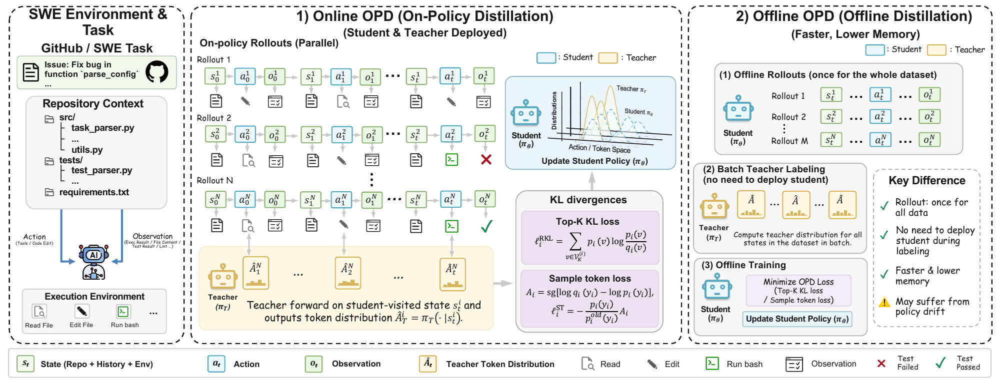

# SWE-OPD: On-Policy Distillation for Agentic Coding


This repository is the reference implementation behind the paper
*SWE-OPD: On-Policy Distillation for Agentic Coding*. It
conducts a minimal, controlled study of **on-policy distillation (OPD)** for
software-engineering (SWE) coding agents: a *small student* model interacts
with executable repositories, and a *larger teacher* supervises the prefixes
that the student itself visits — no reinforcement learning, no filtering by
task success, no data curation.

Two pipelines are provided:

| Package | Variant | Trajectories | Teacher scoring |
|---|---|---|---|
| [`vanilla_opd/`](vanilla_opd/README.md) | **SWE-OPD (online)** | refreshed by the evolving student | on the fly, over HTTP (sglang) |
| [`offline_opd/`](offline_opd/README.md) | **Offline SWE-OPD** | one rollout of the initial student | once, cached (phase 2) |


## Method overview

A SWE task is a sequential decision problem: an issue plus a repository, run inside an executable sandbox. The student acts through the ScaleSWE
`edit_fn_calling` scaffold — `str_replace_editor`, `execute_bash` and `finish` —
until it submits a patch or exhausts the interaction budget. Tool observations
enter the conditioning context, but **only student-generated tokens receive
supervision**. The frozen teacher scores the same prefixes with identical
context, and the student is trained against those scores with one of two
objectives (Figure below, from the paper):

- **RKL** — a top-`K` reverse-KL loss on the student's current top-`K`
  candidates (`K = 128` by default), and
- **ST** — a sampled-token loss that uses the teacher log-probability of the
  token the student actually generated.



Offline SWE-OPD decouples the three stages: (1) the *initial* student rolls out
all trajectories, (2) the teacher scores each saved prefix once (cached teacher
top-1024 support, with the cached 1024th-token probability as an upper-bound
fallback), and (3)
training replays the cache with a **dynamic** student top-`K` support — the
teacher never has to be online again. The same offline pipeline also supports a
teacher with a **different tokenizer** (naive GOLD-style span alignment for the
ST objective).

## Headline results

**Capability transfer (ScaleSWE, 5K queries).** Qwen3.5-9B supervised by
Qwen3.6-27B; scores are mean resolve rate (%) over four runs on SWE-bench
Verified (500), Pro (731) and Multilingual (300):

| Method | Verified | Δ | Pro | Δ | Multilingual | Δ |
|---|---|---|---|---|---|---|
| Student baseline | 57.9 | | 35.9 | | 43.0 | |
| Teacher Rollout Distillation (SFT) | 54.8 | −3.1 | 34.5 | −1.4 | 40.5 | −2.5 |
| RL (UniAgent) | 59.2 | +1.3 | – | | – | |
| SWE-OPD (RKL) | 60.5 | +2.6 | **39.4** | +3.5 | **45.8** | +2.8 |
| SWE-OPD (ST) | **61.7** | +3.8 | 37.9 | +2.0 | 45.2 | +2.2 |

RL (UniAgent) was evaluated on Verified only. Both OPD objectives improve on
all three benchmarks, while SFT on unfiltered
teacher rollouts degrades the student — the supervision *source* (student
prefixes vs. teacher prefixes) matters, not merely the token signal.

**Offline supervision on the internal dataset (≈4K tasks, matched training
budgets).** This is from the paper: online and offline SWE-OPD
for both model pairs, plus the cross-tokenizer run. All offline configurations
improve over their student baselines on all three benchmarks — freezing the
interaction histories does not prevent effective learning.

| Qwen3.5-9B ← Qwen3.6-27B | Verified | Δ | Pro | Δ | Multilingual | Δ |
|---|---|---|---|---|---|---|
| Student baseline | 57.9 | | 35.9 | | 43.0 | |
| SWE-OPD (RKL, online) | 61.6 | +3.7 | 38.4 | +2.5 | 44.3 | +1.3 |
| SWE-OPD (ST, online) | 61.3 | +3.4 | **38.7** | +2.8 | 43.1 | +0.1 |
| Offline SWE-OPD (RKL) | 60.2 | +2.3 | 38.0 | +2.1 | 45.3 | +2.3 |
| Offline SWE-OPD (ST) | **63.7** | +5.8 | 36.5 | +0.6 | **46.0** | +3.0 |

| GLM-4.5-Air ← GLM-5.2 | Verified | Δ | Pro | Δ | Multilingual | Δ |
|---|---|---|---|---|---|---|
| Student baseline | 59.9 | | 35.8 | | 41.6 | |
| SWE-OPD (ST, online) | **60.4** | +0.5 | 37.1 | +1.3 | **45.0** | +3.4 |
| Offline SWE-OPD (ST) | **60.4** | +0.5 | **37.5** | +1.7 | 44.6 | +3.0 |

> **⭐ Highlight — cross-tokenizer capability transfer (GLM-4.5-Air ←
> DeepSeek-V4-Flash-0731).** Each model family uses a *different tokenizer*;
> the teacher's vocabulary is not the student's. The naive GOLD-style span
> alignment merges tokens whose spans differ between the two tokenizations,
> after which offline ST training alone (no cross-vocabulary mapping, no
> change to the objective) still delivers the **largest gains of the study on
> Pro (+3.9) and Multilingual (+4.6)**:
>
> | Method | Verified | Δ | Pro | Δ | Multilingual | Δ |
> |---|---|---|---|---|---|---|
> | Student base (GLM-4.5-Air) | 59.9 | | 35.8 | | 41.6 | |
> | **Offline SWE-OPD (ST)** | **62.5** | **+2.6** | **39.7** | **+3.9** | **46.2** | **+4.6** |
>
> Δ is relative to the GLM-4.5-Air baseline. This shows OPD is **not limited to
> same-family teachers**: a stronger teacher from another model family (and
> vocabulary) can transfer coding capability into the student.

**Cost.** Relative to our online implementation, offline execution reduces
end-to-end GPU-hours from 1024 to 416 (2.46×) for Qwen3.5-9B and from 2808 to
768 (3.65×) for GLM-4.5-Air — **59.4% and 72.6% fewer GPU-hours** — and the
sequential stages (rollout 176/368, teacher scoring 48/160, OPD training
192/240 GPU-hours) reuse one GPU pool, halving the peak allocation from 64 to
32 GPUs and making SWE-OPD feasible on substantially smaller clusters.

**A decreasing loss is not always improved behaviour.** Under RKL,
GLM-4.5-Air develops severe repetition even as its training loss falls, while
ST stays stable; a gradient analysis of the truncated surrogate points to a
*support-mass gradient* that can shift probability outside the scored
candidates (see the paper for details).

## Key findings

1. **Capability transfer in agentic coding.** Teacher supervision on
   student-visited prefixes transfers coding capability across model scales
   (and, offline, across tokenizers), without RL or trajectory filtering — the
   cross-tokenizer run (GLM-4.5-Air ← DeepSeek-V4-Flash-0731) delivers the
   largest gains on Pro and Multilingual in the study. The
   top-`K` ablation shows gains persist for `K ∈ {128, 256, 512, 1024}` with no
   consistent benefit from larger supports; `K = 128` is the default (top-128
   captures ≈99.97% of teacher probability mass on average even though
   teacher–student top-128 set overlap is only ≈62.1%).

2. **Trajectory refresh is not required.** Cached supervision on fixed
   initial-student trajectories improves over the student baselines on every
   benchmark, with benchmark-dependent accuracy relative to online training,
   while cutting GPU-hours by 59.4–72.6% and halving peak GPU
   allocation — a resource-efficient alternative, not a strict replacement.
3. **Reliability beyond loss reduction.** Under the top-K RKL loss, a
   decreasing loss does not always reflect improved agent behaviour (see the
   paper for the support-escape analysis), which motivates evaluating SWE
   distillation by downstream resolution, training behaviour and resource cost.

## Repository layout

```
swe-opd/
├── offline_opd/            # Offline SWE-OPD: 3-phase pipeline (rollout → teacher
│   │                       # scoring → training) + the shared sglang / Megatron-LM
│   │                       # source trees + the eval harness
│   └── slime/examples/coding_agent_opd/
│       ├── scripts/offline_opd/        # phase1/2/3 launchers, formulas, data contract
│       └── eval/                       # benchmarks.json, run_eval.sh, QUICK_EVAL_GUIDE.md
├── vanilla_opd/            # Online SWE-OPD: fully-async pipeline (train_async.py),
│   └── slime/examples/coding_agent_opd/  # agent loop, OPD loss, launch scripts
└── figures/                
```

`vanilla_opd` reuses `offline_opd`'s sglang and Megatron-LM source trees
through `GOLDEN_OPD_DIR` rather than vendoring them twice.

## Implement it yourself

> This is an **implementation reference**: rollouts depend on Baidu's internal
> **RLE platform** (*Reinforcement Learning Environment*, our internal
> RL-environment platform), which provisions the SWE sandbox pods — end-to-end
> reproduction requires it or a substitute sandbox backend.

**Online OPD (fully-async).** See [`vanilla_opd/README.md`](vanilla_opd/README.md):

```bash
cd vanilla_opd
bash env/setup.sh                     # build the environment (~1 h; see env/env.readme.md)
source env/env.sh
cd slime
# single node: 8 GPUs = teacher(6,7) / actor(0,1) / rollout(2-5)
bash examples/coding_agent_opd/scripts/run-qwen3.5-9B-coding-opd-fully_async-singlenode-2tr-2te-4ro_scaleswe_topk128.sh
```

**Offline OPD (three phases).** See [`offline_opd/README.md`](offline_opd/README.md):

```bash
cd offline_opd && source .venv/bin/activate        # install: see README
cd slime
export HF_CHECKPOINT=/path/to/student_hf_checkpoint
export LOAD_PATH=/path/to/student_torch_dist_checkpoint
export TEACHER_MODEL=/path/to/teacher_hf_checkpoint
bash examples/coding_agent_opd/scripts/offline_opd/start-offline-opd.sh phase1
bash examples/coding_agent_opd/scripts/offline_opd/start-offline-opd.sh phase2
SCORED_DIR=/path/to/phase2_scored \
  bash examples/coding_agent_opd/scripts/offline_opd/start-offline-opd.sh phase3
```

The loss formulas and monitoring metrics are fixed in
[`OFFLINE_OPD_FORMULAS.md`](offline_opd/slime/examples/coding_agent_opd/scripts/offline_opd/OFFLINE_OPD_FORMULAS.md);
the data contract and multi-node flow are in
[`PLAN.md`](offline_opd/slime/examples/coding_agent_opd/scripts/offline_opd/PLAN.md).

**Evaluation** (shared by both pipelines, same scaffold/tools/scoring):
`offline_opd/slime/examples/coding_agent_opd/eval/` — `run_eval.sh` +
`benchmarks.json` + [`QUICK_EVAL_GUIDE.md`](offline_opd/slime/examples/coding_agent_opd/eval/QUICK_EVAL_GUIDE.md).
The harness is OpenAI-compatible, so any served checkpoint can be evaluated.

### What you need

- Linux x86_64 with NVIDIA GPUs (tested on Hopper and Blackwell), CUDA 12.9,
  Python 3.12 + uv, and build tools (`cmake`, `ninja`, `protobuf-compiler`,
  Rust toolchain for sglang `sglang-grpc`).
- A SWE sandbox backend for rollouts (via RLE, see the note above); sandbox
  credentials go in `slime/.secret/.key.sh` (gitignored). A GitHub proxy is
  required at rollout time because SWE-bench spec building fetches
  `raw.githubusercontent.com` without a timeout.
- Model checkpoints: student (HF + Megatron dist checkpoint) and teacher (HF,
  sglang-servable). The paper's settings: AdamW at a constant learning rate
  `1e-6`, one epoch over the training subset, rollout batch 64, 128K context,
  `T=1.0`, `top-p=0.95` at evaluation, ≤100 (Verified) / ≤150 (Pro,
  Multilingual) steps.

## Citation

If you find our paper or this repository useful, please consider citing:

```bibtex
@misc{he2026sweopdonpolicydistillationagentic,
      title={SWE-OPD: On-Policy Distillation for Agentic Coding}, 
      author={Yuhang He and Yanyu Chen and Chuanzhe Guo and Jie Zhu and Zichen Tian and Hongyu Ge and Zixuan Ren and Huang He and Bingjin Chen and Junyuan Shang and Shuohuan Wang and Yongqi Zhang and Irwin King and Jing Liu},
      year={2026},
      eprint={2611.21020},
      archivePrefix={arXiv},
      primaryClass={cs.AI},
      url={https://arxiv.org/abs/2611.21020}, 
}
```

## Acknowledgments and licenses

The SWE-OPD implementation in this repository is released under the
[MIT License](LICENSE); it derives from the following open-source projects,
each of which keeps its original license:

- [THUDM/slime](https://github.com/THUDM/slime) (Apache-2.0)
- [sgl-project/sglang](https://github.com/sgl-project/sglang) (Apache-2.0)
- [NVIDIA/Megatron-LM](https://github.com/NVIDIA/Megatron-LM)
- [R2E-Gym](https://r2e-gym.github.io/) (agent backend and evaluation protocol, vendored under `3rdparty/`)

